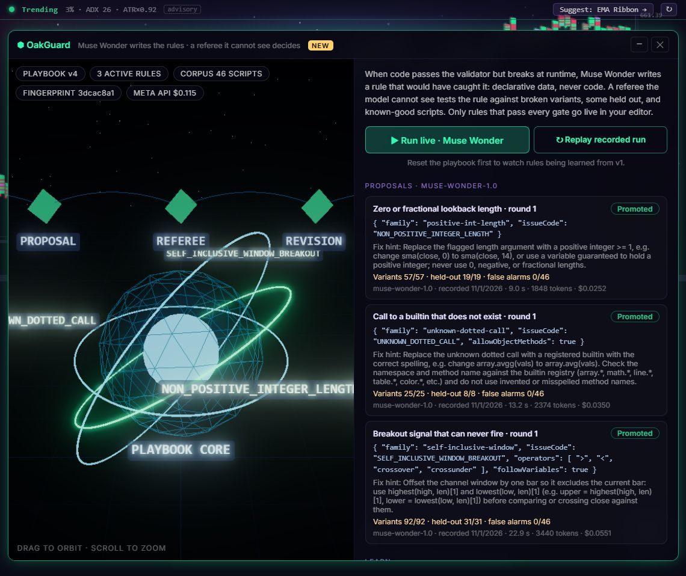

<div align="center">

# DAFE OakGuard

**Muse Wonder writes the rules. A referee it cannot see decides which ones go live.**

Verification for AI-written trading code, built on the DAFE Charts terminal during the
Meta Global AI Developer Hackathon (Oct 26 – Nov 4, 2026).

[](https://github.com/DSKYZ-dev/DAFE-OakGuard/actions/workflows/ci.yml)


</div>



## The problem

Ask an AI for a trading indicator and it will write one that compiles, passes the validator, and
is quietly wrong. A breakout compared with `highest(high, 20)`, which includes the current bar,
can never fire. A length of `0` computes nothing. A misspelled builtin returns zero. The chart
looks fine and nobody notices until they have trusted the signal.

Checkers catch the bugs someone thought of. OakGuard learns the ones nobody wrote a check for,
and proves each new check before it goes live.

## How it works

1. **Find an escape.** Runtime oracles run a script on four synthetic markets (2,400 bars) and
   prove it broken: an output that is never finite, a signal that never fires. The baseline
   validator accepted it.
2. **Muse Wonder proposes a rule.** It sees the script and the evidence and answers with one
   rule in a fixed rule language, as schema-constrained JSON. Data, never code.
3. **A referee it cannot see decides.** The rule is scored against broken variants of the same
   bug (a third of them held out from the model) and 46 known-good scripts: the shipped library
   plus contrast scripts that sit right next to each bug class.
4. **Rejected rules come back with evidence.** The reason, the visible variants missed and the
   false-positive line go back to the model, which may revise. Held-out variants are reported
   as a count only.
5. **Promoted rules enforce everywhere.** They run inside the validator used by the editor, the
   agent's fix loop and the backtest pre-flight, for every script from then on.

Every exchange is recorded with its model, prompt hash, tokens and cost. A replay re-grades the
recorded text with today's referee; verdicts are never replayed.

## Results

| | |
|---|---|
| Rules Muse Wonder wrote for the three escape classes | **3 of 3 promoted**, first round, $0.12 in total ([recorded run](apps/web/src/oakguard/recorded-run.json)) |
| Broken variants caught by those rules | **174 of 174**, including **58 of 58 held out** from the model |
| False alarms on the 46 known-good scripts | **0** |
| Flawed rules the referee must reject (too narrow, too broad, wrong family, malformed) | **9 of 9 rejected** (`npm run verify:proposer`) |
| Muse Spark first drafts that pass the validator | **22 of 32** ([learning curve](docs/reports/LEARNING_CURVE.md)); 20 before the lexer fix below |
| Silent defects in those drafts, and learned-rule false alarms on them | **0** and **0** |
| Live editor acceptance on Muse Spark 1.3 | **110 of 110** prompts across 10 consecutive runs; **11 of 11** re-run after the engine fixes, with every role on Meta |

**Bugs OakGuard found in our own engine.** The runtime oracles flagged shipped scripts whose
signals could never fire. The causes were real interpreter bugs, now fixed: every `crossover()`
call with variable arguments shared one cached result, and `sma()`/`ema()` stayed NaN forever
after a single leading NaN, so the Stochastic Helix `%D` line had been dead. Measuring Muse Spark's
drafts also showed that 5 of 32 failed only because the lexer could not read `1e-9`.

## Meta models in the product

| Model | Role | Where |
|---|---|---|
| **Muse Wonder** (`muse-wonder-1.0`) | Writes OakGuard rules from runtime evidence and revises them on counterexamples (structured output) | `apps/web/src/oakguard/proposer.ts` |
| **Muse Spark 1.3** | OakScript coder (the editor agent) and trade advisor | `apps/web/src/trade-advisor/` |
| **Muse Spark 1.3**, image input | 👁 Look: reads the rendered chart and lists what it can and cannot see from the request | `apps/web/src/visual-check.ts` |
| **Muse Voice Transcribe** | 🎤 Push-to-talk in the editor, biased toward trading vocabulary | `apps/web/src/meta-voice.ts` |

Keys stay on your machine: the backend holds them encrypted and proxies every call
(`/api/meta/structured`, `/api/meta/transcribe`).

## Try it

**In a browser, no install:** the judge build replays the recorded Muse Wonder run and
re-grades it with the referee in your browser.
`https://dskyz-dev.github.io/DAFE-OakGuard/?oakguard=1&backend=none`

**Headless, no API key (about a minute):**

```bash
npm install
npm run verify:proposer   # recorded Muse Wonder run re-graded, referee self-test, oracles, engine fixes
npm run verify:oakguard   # the full loop, offline, plus the report
npm run verify:honesty    # backtest procedure certificate
```

**Live, with a Meta Model API key:**

```bash
pip install -r backend/requirements.txt
npm run backend           # http://127.0.0.1:8788, then Settings → Provider API Keys → Meta
npm run dev               # http://127.0.0.1:5173/?oakguard=1 → Reset playbook → ▶ Run live
npx tsx tools/verify/oakguard-live.ts          # the same loop from the command line, recorded
npx tsx tools/verify/learning-curve.ts mine    # 32 fresh Muse Spark drafts, then: curve
```

## What is new

The terminal underneath (charts, the OakScript language, the advisor UI) existed before the
event. [HACKATHON_CONTRIBUTIONS.md](HACKATHON_CONTRIBUTIONS.md) lists what was built during it, and
the baseline is tagged `pre-hackathon-baseline` in this repository, so
`git diff --stat pre-hackathon-baseline main` shows every change.

## Limits

- The rule language has three families. A bug that no family can express is found by the
  oracles but cannot be learned yet; each new family is the next step.
- "No false alarms" means none on the 46-script corpus, not on every script anyone could write.
- The oracles run synthetic markets. A legitimately rare signal could look dead there.
- With the hardened coder prompt, Muse Spark's first drafts rarely contained a silent defect in
  our sample; most of its mistakes are caught by the validator. The playbook's measured value on
  those drafts is precision (no false alarms), and its generalisation is measured on held-out
  variants.
- The backtest certificate certifies the procedure, not the returns. Nothing here is financial
  advice.

## Documentation

| | |
|---|---|
| [HACKATHON_CONTRIBUTIONS.md](HACKATHON_CONTRIBUTIONS.md) | What was built during the event, and how to verify it |
| [docs/HACKATHON.md](docs/HACKATHON.md) | Pitch, demo script, judge FAQ |
| [docs/SUBMISSION.md](docs/SUBMISSION.md) | Text for the submission form |
| [docs/reports/LEARNING_CURVE.md](docs/reports/LEARNING_CURVE.md) | Muse Spark first drafts, measured |
| [docs/TERMINAL.md](docs/TERMINAL.md) | The DAFE Charts terminal underneath (pre-existing) |
| [docs/ARCHITECTURE.md](docs/ARCHITECTURE.md) · [docs/SETUP.md](docs/SETUP.md) · [docs/USER_GUIDE.md](docs/USER_GUIDE.md) | Architecture, setup, user guide |

## License

MIT, see [LICENSE](LICENSE).

> DAFE Charts is analysis software, not financial advice. Market data may be delayed, incomplete
> or synthetic (the status bar always says which).
