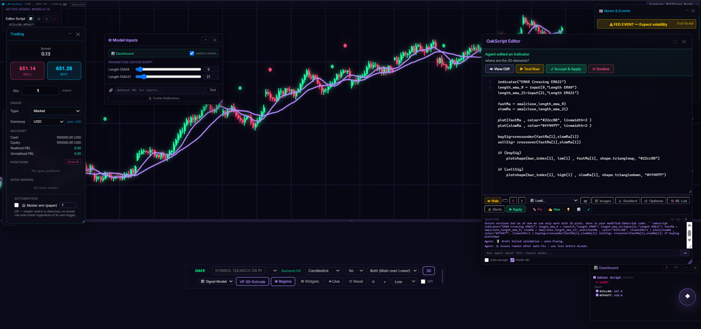

<div align="center">

# DAFE Charts

**An offline-first AI trading terminal — real-time charts, a purpose-built indicator
language that renders in 2D _and_ 3D, and a trade advisor that runs on your own GPU.**


</div>



<p align="center">
  
  
</p>

## New in this submission: DAFE OakGuard

Built during the Meta Global AI Developer Hackathon (Oct 27 – Nov 4, 2026). The trading terminal below is the pre-existing base. [docs/HACKATHON.md](HACKATHON.md) lists exactly what was built during the event.

OakGuard is a verification layer for the indicator code an AI writes. The app runs on Meta's `muse-spark-1.3` for both its editor and its trade assistant. Candidate validation rules come from a hand-written catalogue for now; a live model as proposer is the next step. An independent, deterministic referee accepts a rule only if it catches the planted bugs and wrongly flags none of the known-good scripts, and it records every decision with its evidence. It also certifies the procedure behind every backtest: no lookahead, fills at the open of the entry bar, costs charged, a reserved out-of-sample period. It certifies the procedure, not the returns.

Verify the claims with three headless commands (no API keys needed):

```powershell
npm run verify:oakguard   # rule promotion and rejection, with counterexamples
npm run verify:honesty    # backtest certificate and forming-bar controls
npm run verify:intent     # every indicator a request names must be computed
```

The live Meta run is `npx tsx tools/verify/final-limit-run.ts acceptance --set all --repeat 10 --fail-fast` (needs the backend and a Meta key). Its per-run records are in `tools/verify/`. Latest result: 10 of 10 runs, 11 of 11 prompts in each, on commit `b64e0e7` (`tools/verify/final-limit-results-acceptance-attempt6-summary.json`).

## What this is

DAFE Charts is a desktop-class charting and market-analysis terminal that runs
on your own machine. It loads live market data, renders it twelve different ways,
lets you write your own indicators in a language built for this engine, and puts
an AI trade advisor next to the chart — on a local model when you have the
hardware, or on any hosted model when you don't.

Nothing phones home. There is no sign-in, no telemetry and no server you have to
trust with your keys: the only outbound calls are the market-data and search
providers you pick.

## Highlights

| | |
|---|---|
| **Own your stack** | Charts, indicators, backtests, ML models and the AI advisor all run locally. Model weights are yours; keys are encrypted at rest on your disk. |
| **A real indicator language** | OakScript is not Pine. A lexer → parser → validator → interpreter pipeline with arrays, circular buffers (`OakRing`) and matrices (`Matrix`) — every script is validated before it touches your chart. |
| **Indicators become 3D scenes** | `plot3d()` compiles the same series into 15 visual styles across four rendering surfaces: a Three.js main-scene takeover, a Three.js lower pane, the isometric canvas, and 2D canvas twins when 3D is off. |
| **An advisor that sees your chart** | The Trade Advisor is given the visible bars, indicators and volume profile on every turn. It can search the web, read the news, speak its answer, and write OakScript for you. |
| **Bring any model** | Local llama.cpp with automatic per-machine sizing, Ollama (local or cloud), or hosted OpenAI-compatible and Anthropic endpoints. Keys never reach the browser — every completion is proxied by the backend. |
| **Verified, not vibes** | A ten-script verification harness plus published math, backtest and adapter audit reports in [`docs/reports/`](reports/). |

## Feature tour

**Charting**
- 12 bar types — candlestick, Heikin-Ashi, Renko, range, volume, tick, Kagi, footprint, line, area, dollar and imbalance bars — plus timeframes from 1m to 1w.
- Volume profile with per-level iso-bar voxels, value area and delta, in 2D and as a 3D heat map.
- Drawing toolkit (horizontal line, trend/ray, rectangle, Fibonacci, channel, text), 6 built-in themes, customisable hotkeys, and opt-in auto-refresh that reloads the newest bars from the selected data source.
- Performance modes (Low → Ultra) that scale shadows, gradients and particles to your GPU.

**OakScript**
- Write indicators in the built-in editor; run them as an overlay, a lower pane, or a full 3D scene (`pane="3d"`).
- 30+ standard functions, 15 `plot3d` styles, drawing objects (lines, boxes, polylines, circles, arrows, tables, fills, Fibonacci/Gann overlays, images).
- The AI coder writes OakScript too: ask for an indicator in plain language, watch it validate, test it, then accept it.
- In-app language reference (`docs.ts`) and a retrieval endpoint that keeps the model honest about syntax.

**AI Trade Advisor**
- Local llama.cpp with GGUF introspection and per-machine sizing (context, GPU layers, batch, threads).
- Ollama local and Ollama Cloud, OpenCode, OpenRouter, OpenAI, Anthropic, OrcaRouter, NVIDIA NIM, and any custom OpenAI-compatible endpoint.
- Chart context injection, web search (keyless DuckDuckGo or SerpAPI), news and Fed-event feed, voice in (speech recognition) and out (gTTS), conversation memory, and a token optimiser.
- An ML lab on the backend: train and predict with classical models (gradient boosting, MLP, logistic, tabular Q-learning) or, optionally, torch-backed LSTM/DQN.

**Data**
- Yahoo Finance (free) or Massive/Polygon (paid), plus any added provider adapter. Real bars only: nothing synthetic is mixed into the chart.
- 95 built-in symbols plus any Yahoo ticker; market-hours awareness across equities, futures, forex, crypto and foreign sessions; synthetic fallback when every provider is down (clearly labelled).
- An optional standalone WebSocket relay (`relay/`) that broadcasts 10-second OHLCV ticks — Binance for crypto, Polygon/Massive for futures — deployable to Render.

**Mobile**
- A Capacitor Android app that reuses the same TypeScript core, with its own provider-key screen and a native HTTP bridge.

## Quick start

Prerequisites: **Node.js 18+**, **Python 3.10+**, and Windows for the one-click launchers (the pieces run anywhere).

```bash
npm install                                    # frontend + shared packages
pip install -r backend/requirements.txt        # FastAPI backend

# optional: local LLM — drop a .gguf file into models/ and install llama.cpp
# (CUDA build recommended; the app measures VRAM and sizes the model itself)
```

Then either double-click **`start.bat`** (starts LLM → backend → frontend and opens the browser), or run the pieces yourself:

```bash
npm run backend     # http://127.0.0.1:8788
npm run dev         # http://127.0.0.1:5173
```

Launch flags: `start.bat -no-llm` (charting only, fastest), `start.bat -vision` (image mode, needs an mmproj file), `start.bat -reset` (kill everything and clear caches).

**No GPU?** Skip the local model entirely. Open **Settings → Provider API Keys**, paste a key for any hosted provider, and point the Trade Advisor and OakScript Coder at it — the keys are encrypted on the backend and never exposed to the page.

## Repository layout

```
dafe-charts/
├── apps/
│   ├── web/            # desktop web app: charting, OakScript, advisor, trading, backtest
│   │   └── src/        # renderers · bar engines · oakscript/ · trade-advisor/ · data-stream/
│   └── mobile/         # Capacitor Android app sharing the same core (+ android/ project)
├── backend/            # FastAPI server: market data, chat routing, vault, ML lab, model manager
├── packages/types/     # shared TypeScript types
├── relay/              # optional WebSocket tick relay (crypto + futures) for deployment
├── site/               # product / download page for the mobile app
├── docs/               # guides, architecture, design notes, audit reports, screenshots
├── tools/              # verification harness + provider probes
├── scripts/            # Windows debug / deploy / archive helpers
├── models/             # .gguf model files (gitignored) — see models/README.md
└── start.bat           # one-click launcher
```

## Documentation

| Document | Contents |
|---|---|
| [docs/SETUP.md](SETUP.md) | Install, LLM setup, configuration, troubleshooting |
| [docs/USER_GUIDE.md](USER_GUIDE.md) | Every screen and feature, explained |
| [docs/ARCHITECTURE.md](ARCHITECTURE.md) | How the system fits together, module by module |
| [docs/HACKATHON.md](HACKATHON.md) | The pitch, the demo script, what's novel, what's next |
| [docs/design/](design/) | Design notes, including the visual-compiler proposal |
| [docs/reports/](reports/) | Math, backtest and adapter audit reports |
| [docs/development/](development/) | Live progress log, TODO, session handoff notes |
| [tools/](tools/) | Verification harness and provider probes |

## Verification

```bash
npm run lint          # tsc --noEmit across the workspace
npm run build         # production builds for web + mobile
npm test              # OakScript verification harness (mega-test)
npm run verify:stress # 12 bar types × 6 timeframes, 5k bars, deterministic volume
```

The harness executes real OakScript through the same lexer, parser, validator and
interpreter the app uses, against synthetic bars with known properties — extreme
prices, zero volume, NaNs and rapid timeframe changes included. The full run
currently asserts **2,171,421 checks across eight suites with zero failures**.
Results and the audit reports that came out of it live in
[docs/reports/](reports/).

## License

MIT — see [LICENSE](../LICENSE).

> DAFE Charts is analysis software, not financial advice. Market data may be
> delayed, incomplete or synthetic (the status bar always says which). Nothing
> here is a recommendation to buy or sell any instrument.
